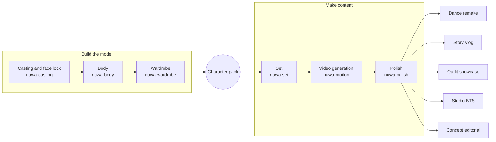

<p align="center">
  <picture>
    <source media="(prefers-color-scheme: dark)" srcset="./docs/logo-dark.svg">
    
  </picture>
</p>

<h3 align="center">Let your AI agent build an AI model who can stay on camera for the long run</h3>
<p align="center">Lock the face, the body and the wardrobe, then have her dance, vlog, show outfits and shoot editorials. New clothes, new sets, still the same person.</p>

<p align="center">
  <a href="#install"><strong>Install</strong></a>
  &nbsp;&bull;&nbsp;
  <a href="#usage"><strong>Usage</strong></a>
  &nbsp;&bull;&nbsp;
  <a href="#the-pipeline"><strong>Pipeline</strong></a>
  &nbsp;&bull;&nbsp;
  <a href="./README.md"><strong>简体中文</strong></a>
</p>

<p align="center">
  <a href="./LICENSE"></a>
  
  
  
  
</p>

## Nuwa

> Shape the clay, breathe the life.

Nuwa is a set of skills for AI agents (Claude Code, Codex and others) that turns making an AI model, and then filming content with her, into one end-to-end workflow. The name comes from Nüwa, who in Chinese myth shaped people from clay. First you shape her: lock the face, the body and the wardrobe into a reusable **character pack**. Then you breathe life into her: pick the set, generate video and polish the result.

It is not a prompt collection. What each stage must deliver, which reference image does which job, when to switch models, and where to look first when a result is wrong are all written as methods an agent can follow. Prompts are only one part, and each one names the model it was tested on.

> **Note:** the skills themselves are written in Chinese. Agents read them fine in any language, and will reply in yours.



Build the character once and film many kinds of content with her. A new content format is a new branch on the content side; the model never has to be rebuilt.

## Install

```bash
npx skills add castle-x/nuwa -g
```

This installs all 14 skills. Or clone the repo and symlink them, so `git pull` updates everything:

```bash
git clone https://github.com/castle-x/nuwa.git
cd nuwa
./scripts/install.sh                                    # defaults to ~/.claude/skills
./scripts/install.sh ~/.claude/skills ~/.agents/skills ~/.codex/skills
```

Existing skills with the same name are never overwritten.

**Requirements:** the skills are documents and work as soon as they are installed. The helper scripts (confirmation sheet, grid splitting, body measurement, frame sampling) need Python 3 and Pillow; frame sampling also needs ffmpeg. `image-upscale` installs PyTorch and its upscaling models on first use.

**Models:** Nuwa is free and not tied to any model service. Bring your own accounts for image and video generation; the ones used most are GPT Image, Nano Banana Pro, Seedream and Wan 3.0. Before every paid generation, the agent lists the model, parameters, prompt and reference images for you to confirm.

## Usage

Start a session in any project directory and say what you want:

```text
/nuwa I want an AI model for a fashion account: early twenties, cool and reserved. References are in ./refs/
```

Already have a character? Go straight to content:

```text
/nuwa-studio Put her in the grey knit outfit and have her dance to this: ./ref/dance.mp4
```

Or call a single stage directly:

```text
/nuwa-wardrobe Dress her in this outfit and give me a full-body turnaround: ./outfits/cardigan.jpg
/nuwa-polish Her face drifts in this clip. What is going wrong? ./out/clip-03.mp4
/nuwa-aesthetic Break down why this image works, then recreate it with my model: ./ref/poster.jpg
```

The agent first looks for the model's production file, works out which stage your request belongs to, asks which models you can use, and tells you what this stage will hand over.

## Why Nuwa

- **The face stays put.** You approve one frontal base face first, then a 2×2 face-lock sheet is made from it. Every later stage uses that sheet as the identity source, never a frame grabbed from some video.
- **No bobblehead.** Head-to-body proportion comes from exactly one source: a full-body image with the whole body in frame. A face close-up decides what she looks like, not how big her head is.
- **The workflow is universal; prompts are not.** The workflow holds for any model, but each prompt holds only on the model it was tested on. A built-in model capability sheet records what each model is good at, which phrasings work and which ones backfire.
- **Numbers are for people; proportions are for models.** Models cannot execute height or measurements, so every spec has two layers, and prompts carry only the proportions and shapes a model can actually draw.
- **When something breaks, you know where to look.** Frame sampling, a failure atlas, one variable at a time. Face drift, appearance leaking from the reference video, stiff bodies and photographers walking into frame each have a likely cause and a first fix to try.
- **The next session picks up where you left off.** Each model has a production file holding exact prompts, reference roles, model parameters, real output pixels and your feedback, so nothing is lost when a conversation gets compacted.

## The pipeline

### Build the model: a character pack

| Stage | Skill | Delivers |
|---|---|---|
| Entry point | `nuwa` | Routes the three stages; rules that apply everywhere; model capability sheet; pre-generation confirmation sheet |
| 1 Casting and face lock | `nuwa-casting` | Reference review → frontal base face → 2×2 face-lock sheet (1:1, neutral expression, no clothing) → character lock spec |
| 2 Body | `nuwa-body` | Two-layer body card; full-body turnaround locks (fitted base layer and blank mannequin); head-to-body measurement |
| 3 Wardrobe | `nuwa-wardrobe` | Structured garment description in six fixed parts; composited full-body image of face plus outfit; wardrobe entry |

### Make content with the pack

| Stage | Skill | Covers |
|---|---|---|
| Entry point | `nuwa-studio` | Checks the character pack is complete and picks the content format |
| Set | `nuwa-set` | Reference shot → set card; empty plate first, then props, then the person |
| Video generation | `nuwa-motion` | Reference roles, nine-part prompt structure, physical motion, stopping appearance transfer, multi-shot continuity |
| Polish | `nuwa-polish` | Frame diagnosis, failure atlas, per-panel retouching, editing, acceptance checks |

### Five content formats

| Format | Skill | Driven by |
|---|---|---|
| Dance remake | `nuwa-dance` | A reference video, converted to a blank white model first when the dancer looks too different |
| Story vlog | `nuwa-vlog` | Story → shot list → continuity anchors, stitched from several shots |
| Outfit showcase | `nuwa-showcase` | The clothes are the subject: tight framing, hand action chains, fast cuts grouped by outfit |
| Studio BTS | `nuwa-bts` | Phone side-angle view, gear at the frame edge, poses timed to the flash |
| Concept editorial | `nuwa-aesthetic` | Contrast, a single focal point, a unified base color and spatial guidance; reference breakdown and slot recombination |

### Tools

| Skill | Purpose |
|---|---|
| `image-upscale` | Local non-generative upscaling (DAT2, HAT, RealPLKSR) to 2K/4K/8K without changing the face. Runs on Apple silicon, NVIDIA GPUs or CPU |

## Repository layout

```text
skills/
  nuwa/              entry point, model capability sheet, confirmation-sheet script
  nuwa-casting/      casting and face lock, with the 2×2 split script
  nuwa-body/         body, with crop and proportion scripts
  nuwa-wardrobe/     wardrobe and outfit compositing
  nuwa-studio/       content entry point
  nuwa-set/          set
  nuwa-motion/       video generation rules
  nuwa-polish/       polish, with the frame-sampling script
  nuwa-dance/ nuwa-vlog/ nuwa-showcase/ nuwa-bts/ nuwa-aesthetic/
  image-upscale/     faithful upscaling
scripts/install.sh   symlink installer
```

Each `SKILL.md` holds only decisions and flow; details live in that skill's `references/` and are read when needed.

## Responsible use

- Every character is an adult.
- Do not use it to impersonate a real person or to reproduce someone's likeness without permission.
- When recreating game or anime character designs or other people's videos, respect copyright and platform rules.
- Content generated with third-party models is also subject to those models' terms.

## Contributing

Issues and pull requests are welcome. New model findings, prompt phrasings, problems and fixes, and new content formats are all valuable. Please read [CONTRIBUTING.md](./CONTRIBUTING.md) first; it covers how the skills are maintained, such as keeping only conclusions in the shipped skills and naming the model every prompt was tested on.

| | |
|---|---|
| Report a problem | [Open an issue](https://github.com/castle-x/nuwa/issues/new?template=bug_report.yml) |
| Share model findings or request a feature | [Open an issue](https://github.com/castle-x/nuwa/issues/new?template=feature_request.yml) |

## License

[MIT](./LICENSE). The images and videos you make with Nuwa belong to you. The upscaling weights that `image-upscale` downloads at run time come from their upstream projects and keep their own licenses.
