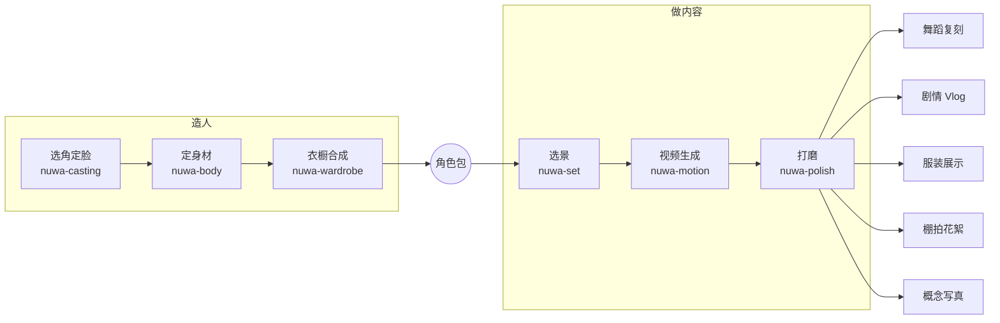

<p align="center">
  <picture>
    <source media="(prefers-color-scheme: dark)" srcset="./docs/logo-dark.svg">
    
  </picture>
</p>

<h3 align="center">让 AI Agent 帮你造一个能长期出镜的 AI 模特</h3>
<p align="center">定脸、定身材、穿衣，再让她跳舞、拍 Vlog、展示服装、拍写真。换衣服换场景，还是同一个人。</p>

<p align="center">
  <a href="#安装"><strong>安装</strong></a>
  &nbsp;&bull;&nbsp;
  <a href="#怎么用"><strong>怎么用</strong></a>
  &nbsp;&bull;&nbsp;
  <a href="#整条流程"><strong>整条流程</strong></a>
  &nbsp;&bull;&nbsp;
  <a href="./README.en.md"><strong>English</strong></a>
</p>

<p align="center">
  <a href="./LICENSE"></a>
  
  
  
  
</p>

## Nuwa

> 抟土为形，一气成人。

Nuwa 是一组给 AI Agent（Claude Code、Codex 等）用的 skill，把 AI 模特从无到有、再到拍成内容的整个过程做成一条流程。名字取自女娲造人：先抟土塑形，定脸、定身材、穿衣，把模特做成一个可以长期复用的**角色包**；再吹一口气让她活过来，选景、生成视频、打磨成片。

它不是一堆提示词合集。每一环要交出什么、参考图怎么分工、什么时候该换模型、结果不对先查哪里，都写成了 Agent 能照着执行的方法。提示词只是其中一部分，每一条都注明了在哪个模型上验证过。



角色做一次，就能拿去拍很多种内容。要加新的内容形式，只在做内容那一层加分支，不用重新造人。

## 安装

```bash
npx skills add castle-x/nuwa -g
```

一次装好全部 14 个 skill。也可以克隆仓库，用软链接安装，之后 `git pull` 就能更新：

```bash
git clone https://github.com/castle-x/nuwa.git
cd nuwa
./scripts/install.sh                                    # 默认装到 ~/.claude/skills
./scripts/install.sh ~/.claude/skills ~/.agents/skills ~/.codex/skills
```

已经存在的同名 skill 不会被覆盖。

**环境**：skill 本身是文档，装上就能用。确认单、切图、测比例、抽帧这几个脚本需要 Python 3 和 Pillow，抽帧还需要 ffmpeg。`image-upscale` 第一次使用时会自动装好 PyTorch 和超分模型。

**模型**：Nuwa 免费，不绑定任何模型服务。生图、生视频用你自己的账号，常用的是 GPT Image、Nano Banana Pro、Seedream 和 Wan 3.0。每次付费生成前，Agent 都会先把模型、参数、提示词和参考图列给你确认。

## 怎么用

在任意项目目录里开一个会话，直接说你要做什么：

```text
/nuwa 我想做一个穿搭账号的 AI 模特，二十出头、清冷感，这是几张参考图：./参考/
```

已经有角色，直接拍内容：

```text
/nuwa-studio 让她穿灰色针织那套，照着这段视频跳一遍：./ref/dance.mp4
```

只做其中一环，可以直接点名子 skill：

```text
/nuwa-wardrobe 把这套衣服给她穿上，出一张全身三视图：./衣服/开衫.jpg
/nuwa-polish 这段视频的脸在漂，帮我看看哪里不对：./out/clip-03.mp4
/nuwa-aesthetic 拆一下这张图为什么好看，然后用我的模特复刻：./ref/poster.jpg
```

Agent 会先找这个模特的制作档案，判断你的请求落在哪一环，问清你手上能用哪些模型，再告诉你这一环会交出什么。

## 为什么用 Nuwa

- **脸不漂。** 先出一张正面基准脸让你确认，再出 2×2 面部锁定图。之后每一环都拿它当身份依据，不拿某次视频的截图凑合。
- **不出大头娃娃。** 头身比例只认一个来源：一张带完整身体的全身图。脸部特写只管长什么样，不管头有多大。
- **流程通用，提示词不通用。** 流程对任何模型都成立，提示词只在验证过的模型上成立。内置一张模型能力速查表，写清每个模型擅长什么、怎么写有效、怎么写会翻车。
- **数字给人看，比例和形态给模型。** 身高三围这类数字模型执行不了，所以每份设定都分两层，提示词里只放模型画得出来的比例和形态。
- **出了问题知道改哪里。** 抽帧诊断、问题图谱，一次只改一个变量。脸部漂移、外观迁移、身体僵硬、摄影师入画，都有对应的原因和先试的修法。
- **下一次会话接得上。** 每个模特一份制作档案：提示词原文、参考图分工、模型参数、实际像素、你的评价都留下来，对话被压缩也不会丢。

## 整条流程

### 造人：做一个角色包

| 环节 | skill | 交出的东西 |
|---|---|---|
| 总入口 | `nuwa` | 分派三个环节；贯穿全流程的规则；模型能力速查表；生成前确认单 |
| 1 选角定脸 | `nuwa-casting` | 参考图评审 → 正面基准脸 → 2×2 面部锁定图（1:1、中性表情、不露服装）→ 角色锁定设定 |
| 2 定身材 | `nuwa-body` | 两层身材卡；全身三视图锁定图（真人紧身打底、白模素体）；头身比测量 |
| 3 衣橱合成 | `nuwa-wardrobe` | 结构化服装描述（六段固定顺序）；脸和服装合成的成品全身图；衣橱条目 |

### 做内容：拿角色包去拍

| 环节 | skill | 负责 |
|---|---|---|
| 总入口 | `nuwa-studio` | 检查角色包是否齐全，选内容形式 |
| 选景 | `nuwa-set` | 对标图 → 场景卡；先定空镜，再加道具，最后加人 |
| 视频生成 | `nuwa-motion` | 参考分工、提示词九段结构、物理动态、防外观迁移、多镜头衔接 |
| 打磨 | `nuwa-polish` | 抽帧诊断、问题图谱、分格修复、剪辑、验收 |

### 五种内容形式

| 形式 | skill | 驱动方式 |
|---|---|---|
| 舞蹈复刻 | `nuwa-dance` | 参考视频；外观差太多时先转白模 |
| 剧情 Vlog | `nuwa-vlog` | 故事 → 分镜 → 连续性锚点，多镜头拼接 |
| 服装展示 | `nuwa-showcase` | 衣服是主角：局部构图、手部动作链、按套装快切 |
| 棚拍花絮 | `nuwa-bts` | 手机侧拍视角、器材入画、闪光节拍 |
| 概念写真 | `nuwa-aesthetic` | 反差、焦点合一、底色统一、空间引导；对标拆解与槽位组合 |

### 工具

| skill | 作用 |
|---|---|
| `image-upscale` | 本地非生成式超分（DAT2、HAT、RealPLKSR），放大到 2K/4K/8K，脸不变。Apple 芯片、NVIDIA 显卡和纯 CPU 都能跑 |

## 仓库结构

```text
skills/
  nuwa/              造人总入口、模型能力速查表、确认单脚本
  nuwa-casting/      选角定脸，含 2×2 切图脚本
  nuwa-body/         定身材，含裁切与比例测量脚本
  nuwa-wardrobe/     衣橱与服装合成
  nuwa-studio/       做内容总入口
  nuwa-set/          选景
  nuwa-motion/       视频生成通用规则
  nuwa-polish/       打磨，含抽帧脚本
  nuwa-dance/ nuwa-vlog/ nuwa-showcase/ nuwa-bts/ nuwa-aesthetic/
  image-upscale/     保真超分
scripts/install.sh   软链接安装脚本
```

每个 skill 的 `SKILL.md` 只写判断和流程，细节放在各自的 `references/` 里，按需读取。

## 使用须知

- 所有角色一律设定为成年人。
- 不要用它冒充真实存在的人，也不要在未获授权时复刻他人的肖像。
- 复刻游戏、动画角色的造型或别人的视频时，注意相关的版权和平台规则。
- 用第三方模型生成的内容，同时受那个模型服务条款的约束。

## 参与贡献

欢迎提 Issue 和 Pull Request。新的模型实测结论、提示词写法、问题和修法、新的内容形式，都很有价值。动手前请先读 [CONTRIBUTING.md](./CONTRIBUTING.md)，里面写了 skill 的维护规则，比如交付版只写结论、提示词要注明适用模型。

| | |
|---|---|
| 反馈问题 | [提一个 Issue](https://github.com/castle-x/nuwa/issues/new?template=bug_report.yml) |
| 补充模型经验或新功能 | [提一个 Issue](https://github.com/castle-x/nuwa/issues/new?template=feature_request.yml) |

## 许可证

[MIT](./LICENSE)。你用 Nuwa 做出来的图片和视频归你所有。`image-upscale` 运行时下载的超分模型权重来自各自的上游项目，适用它们自己的许可证。
